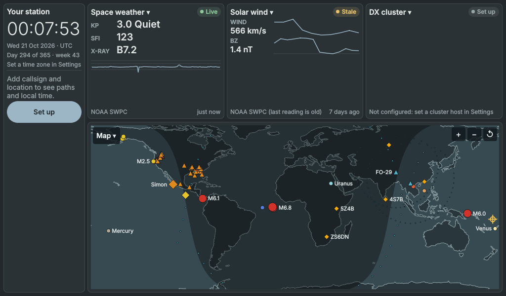
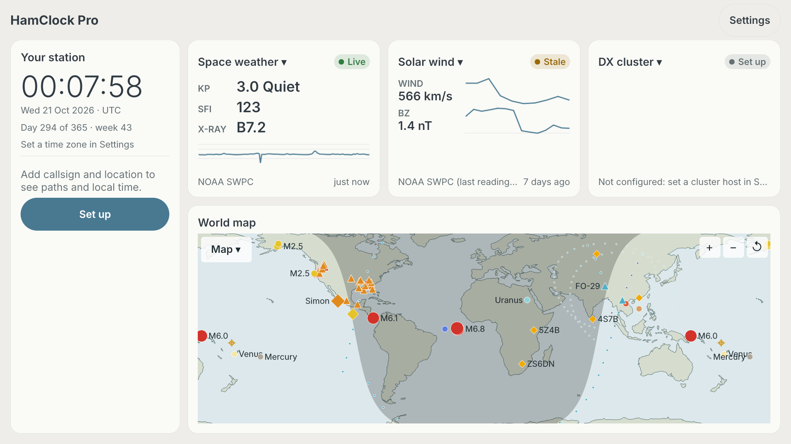
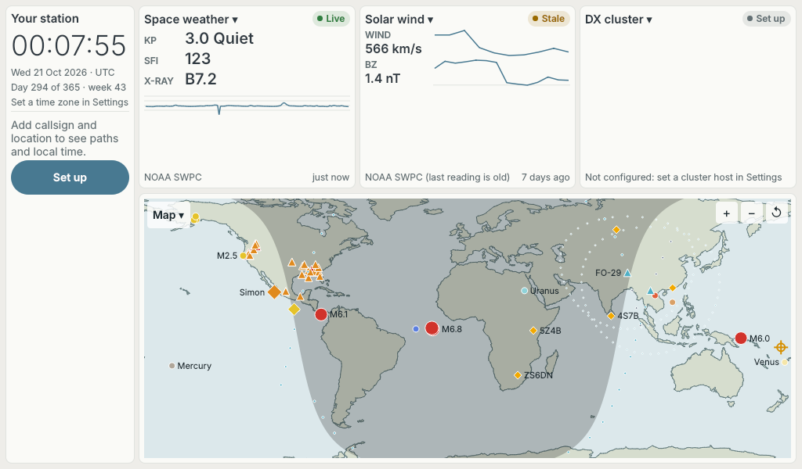
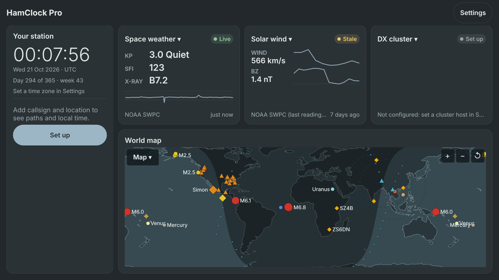

# HamClock Pro

A native amateur-radio dashboard for the Raspberry Pi, from 7-inch touchscreens (1024x600) up to 4K TVs, also built for macOS and iPad. One screen, no scrolling: a station clock, a world map with day/night and overlays, and tappable panes for space weather, spots, weather, satellites and more.

**Development preview.** HamClock Pro is not yet a replacement for the original HamClock and does not claim feature parity with it. See [docs/ROADMAP.md](docs/ROADMAP.md) for the plan to 1.0.

> **Independent project.** HamClock Pro is an original, independently developed application. It is not affiliated with, endorsed by, or derived from the code of the original HamClock or its authors.

## Screenshots

Rendered by the app itself (`--screenshot`) from recorded sample data, not from a device; panes show "Stale" where the sample data is old.

| 7-inch Pi screen, 1024x600 | TV, 1920x1080 |
|---|---|
|  |  |
|  |  |

A macOS window screenshot is not included yet.

## Using it

- **Tap** a pane's title to choose what it shows; **swipe** to step through panes; **long-press** for that pane's options.
- Open **Settings** (a header button on large screens) to set callsign, location, theme, accent colour and data sources.
- **Satellite pass alerts** (Settings > Satellite alerts): pick the amateur satellites you work (or "All workable": ISS, SO-50, AO-91, RS-44, AO-7 and the rest of a curated, AMSAT-checked list), a minimum peak elevation, how many minutes ahead, and quiet hours. iPhone, iPad and Mac get system notifications even with the app closed (the next 48 h, up to 60 alerts, topped up each time the app opens); the Pi and other desktops show a banner, with a chime on Linux. The Passes pane's **Alerts** filter shows the same satellites.
- Panes without a configured source say so ("Set up", "Not configured"); old data is marked Stale. Nothing is presented as live when it is not.

## Features

Grouped as in the pane chooser:

- **Space weather:** Kp, SFI, X-ray, solar wind and IMF, solar trend, band conditions, NOAA scales and alerts, aurora, D-RAP, Dst, SDO solar imagery.
- **DX and contest:** DX cluster, PSKReporter, NCDXF beacons, POTA/SOTA, ADIF log, HamAlert, APRS.
- **Weather and hazards:** local weather, earthquakes, tropical storms, fires, fire-weather and marine warnings.
- **Sky and space:** sun and moon, satellite passes, planets, eclipses, EME, balloons.
- **Station:** clocks, host sensors, GPS, read-only rigctld/rotctld, ADS-B.
- **Map:** day/night, projections, path from DE to DX, and overlays for the panes above.

Many panes are partial; the per-widget status is in [docs/WIDGETS.md](docs/WIDGETS.md).

## Install

- **Raspberry Pi (.deb):** every merge to `main` publishes an arm64 Bookworm `.deb` and a macOS app as the rolling `latest` pre-release on the GitHub Releases page. The automatic updater is planned, not shipped. These builds have not been validated on hardware by this project yet.
- **SD-card image:** planned (tracked in issue #526); not available yet.
- **macOS:** a signed dmg is planned; the CI-built app is not yet signed or notarised.
- **iPad:** via TestFlight, later.

## Data sources and attribution

Data comes directly from public sources such as NOAA SWPC, NASA SDO, Open-Meteo, USGS, NHC, NWS, NASA FIRMS, POTA, SOTA, PSKReporter, SondeHub and CelesTrak (see the data source policy in [docs/ROADMAP.md](docs/ROADMAP.md)). Map data is Natural Earth (public domain); see [docs/map-provenance.md](docs/map-provenance.md).

## Licence

Application source is MIT licensed ([LICENSE](LICENSE)). Qt and system components keep their own licences.

## Reporting bugs

Open a GitHub issue with your version, platform and screen size, and a screenshot if the problem is visual. Developers: see [docs/DEVELOPING.md](docs/DEVELOPING.md).
