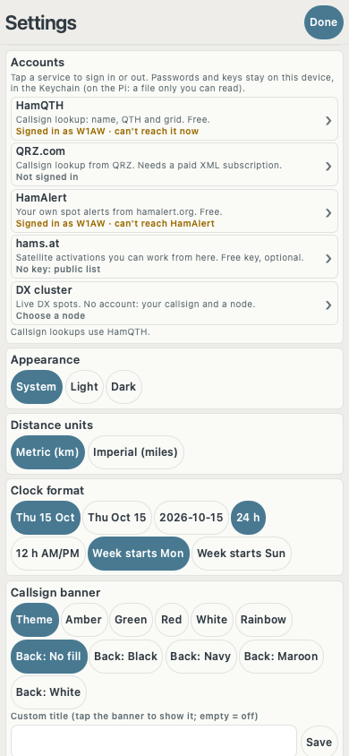
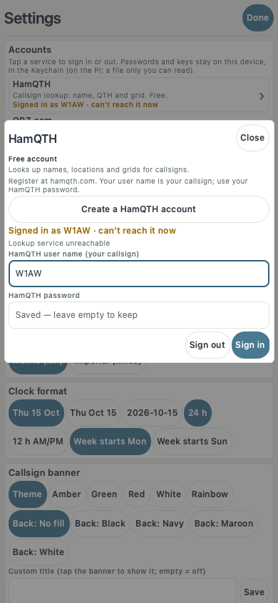

# Accounts and servers

Most HamClock Pro panes need no account. The ones that do are all in **Settings →
Accounts**. Each service has one row showing what it is for and whether it works
("Signed in as W1AW ✓", "Not signed in", "Login rejected", "Checking…"). Tap a row
to open its sheet. The sheet says whether the service is free or paid and has a
**Create an account** button. Enter your details and tap **Sign in**. The app saves
them and checks the login straight away. **Sign out** removes them.

Use the test station **W1AW / FN31pr** in screenshots and bug reports. Never post a
real password, API key or home address.

## Where passwords and keys are kept

- **Mac, iPhone, iPad:** in the system Keychain, under the service `org.hamclockpro.app`.
  Each settings folder (the `-c DIR` option) has its own entries.
- **Raspberry Pi and Linux:** in `credentials.ini` in the settings folder. Only your user
  can read it (mode 0600). It is not encrypted.
- Passwords and keys never go into `options.ini`, saved configurations, logs, status
  text or screenshots. After you sign in, the password field is emptied and shows
  "Saved — leave empty to keep".
- Logins saved by earlier test builds move over automatically. That includes the old
  single "Callsign lookup account" (QRZ.com or HamQTH): it becomes that service's row.

## Which accounts to create, in order

| # | Service | Cost | Needed for | Time |
|---|---------|------|------------|------|
| 1 | DX cluster node | Free, no account (your callsign is the login) | DX cluster, Band activity, Beacons, Watch list, DX spots on the map | 1 min |
| 2 | HamQTH | Free account | Callsign lookup (name, QTH, grid) | 5 min |
| 3 | HamAlert | Free account | HamAlert pane (your own spot alerts) | 10 min, including triggers |
| 4 | hams.at | Free account; the API key is optional | Which satellite activations you can work from your station | 5 min |
| 5 | QRZ.com XML | **Paid** yearly: XML Logbook Data subscription (also in Premium and Platinum) | Callsign lookups from QRZ instead of HamQTH | 10 min |

One lookup service is enough. Start with HamQTH, which is free. If you sign in to both,
lookups use QRZ.com, and the line under the rows says which one is in use.

APRS-IS, PSKReporter, WSPR and RBN need no account. Meshtastic, radio, rotator, GPS and
ADS-B use hardware or programs on your own network.

---

## 1. DX cluster (no account)

- **First:** set your callsign under Settings → Station. Nodes log you in with it, and
  they are for licensed amateurs using their real call.
- **Accounts → DX cluster:** tap a suggested node, or type a host and port. Then tap
  **Connect**. The cluster reconnects straight away; no restart needed.

  | Button | Host | Port | Software, area |
  |--------|------|------|----------------|
  | NC7J | `dxc.nc7j.com` | 7373 | AR-Cluster, USA west |
  | K1TTT | `k1ttt.net` | 7373 | AR-Cluster, USA north-east |
  | W3LPL | `w3lpl.net` | 7373 | DX Spider, USA east |
  | DX Spider UK | `dxspider.co.uk` | 7300 | DX Spider, UK and Europe |

  All four showed a login prompt on 29 Oct 2026. The app never picks a node for you.
- **SSID:** leave it at 0. Set 1–99 only if another program is already logged in to the
  same node with your callsign.
- **Commands after login:** optional. For example, `set/skimmer` turns on skimmer spots
  on DX Spider nodes. The app drops any command that would send something (`dx`,
  `talk`, `announce`…); it only receives.
- **Working:** the row says "Connected to dxc.nc7j.com ✓" and spots appear in the DX
  cluster pane. "Can't reach …" means the host or port is wrong or the node is down.
  Pick another node.

## 2. HamQTH (free)

- **Sign up:** <https://www.hamqth.com/register>.
- **Accounts → HamQTH:** your callsign (the HamQTH user name) and your HamQTH
  password. Tap **Sign in**.
- **Working:** "Signed in as W1AW ✓". Then add the Callsign lookup pane and look up
  `W1AW`.
- **Problems:** "Login rejected" means a wrong user name or password. "can't reach it
  now" means no network, or HamQTH is down.

## 3. HamAlert (free)

- **Sign up:** <https://hamalert.org/register>.
- **Triggers:** HamAlert only sends spots that match your triggers. On hamalert.org,
  open Triggers, add one (for example a callsign, a DXCC entity or POTA), and tick its
  **Telnet** action. Without the Telnet action the login works but no spots arrive.
- **Accounts → HamAlert:** your HamAlert user name and password (no spaces). Tap
  **Sign in**. The app logs in to `hamalert.org` port 7300.
- **Working:** "Signed in as W1AW ✓". Spots appear in the HamAlert pane when a trigger
  fires.
- **Problems:** "Login rejected" means HamAlert refused the login. The app stops trying
  until you change the user name or password.

## 4. hams.at (free, key optional)

- **Without a key:** the hams.at pane shows the public list. The row says "No key:
  public list".
- **With a key:** sign up at <https://hams.at/users/register> and set your grid on
  hams.at. Then open Settings on hams.at and copy the **API key**. In
  **Accounts → hams.at**, paste it and tap **Save key**.
- **Working:** "Key accepted ✓". The pane then shows rows like "workable
  18:02Z-18:09Z". "Key not accepted" means hams.at sent the public list instead. Copy
  the key again.

## 5. QRZ.com XML (paid)

- **Buy:** an **XML Logbook Data** subscription, or a Premium or Platinum package
  (both include it): <https://shop.qrz.com/collections/subscriptions>. A free QRZ
  account can sign in, but it gets only part of each record.
- **Accounts → QRZ.com:** your QRZ user name (usually your callsign) and your QRZ.com
  password. Tap **Sign in**.
- **Working:** "Signed in as W1AW ✓". The sheet shows "XML subscription until …".
  "· no XML subscription" (amber) means the login works but the account has no XML
  subscription.
- **Problems:** "Locked out by QRZ.com for 24 hours" follows repeated failed logins;
  wait a day. "service busy" means QRZ is overloaded; try again later.

---

## No account needed

- **APRS-IS (receive only):** Settings → Spots and feeds → APRS-IS server. The default
  is `rotate.aprs2.net` port 14580. The app logs in with your callsign and `pass -1`,
  so it can never send a position. It shows stations within the radius you set.
- **PSKReporter, WSPR, RBN:** your callsign is all it needs. The WSPR and RBN buttons
  add those sources to the PSKReporter pane.
- **Meshtastic:** a node on your network with Wi-Fi turned on. Settings → Spots and
  feeds → Meshtastic node: its IP address, port 4403. Receive only.
- **Radio, rotator, GPS, ADS-B:** Settings → On this computer: station hardware. The
  app reads from `rigctld` or flrig, `rotctld`, `gpsd` or a serial GPS, and
  PiAware/dump1090. Use `127.0.0.1` when they run on the same computer. Nothing is
  ever sent that changes the radio or moves the rotator. These panes are not on iPhone
  or iPad.

## What only real accounts can confirm

The tests use fake servers that copy each service's documented replies: success,
wrong password, no network, server busy, and the QRZ lockout and non-subscriber
replies. Check these by hand with real accounts before release:

- HamQTH: sign in shows ✓, and a lookup of W1AW works.
- QRZ.com: a subscribed account shows its expiry date; a free account shows the amber
  "no XML subscription".
- HamAlert: sign in reaches ✓; a wrong password shows "Login rejected"; a trigger with
  the Telnet action delivers a spot.
- hams.at: a real key shows "Key accepted ✓" and workable times.
- DX cluster: each suggested node connects with your callsign.
