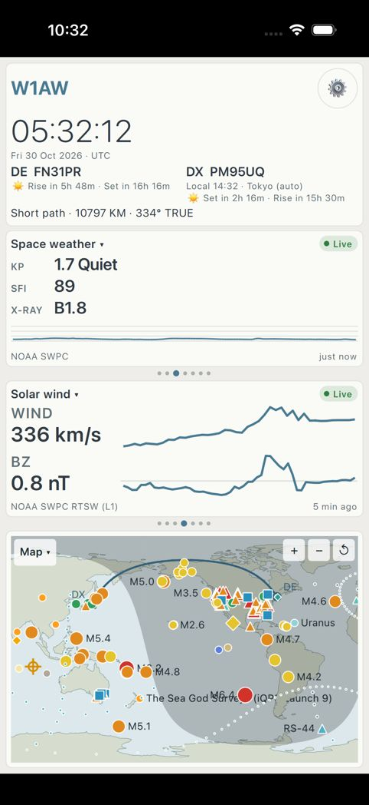
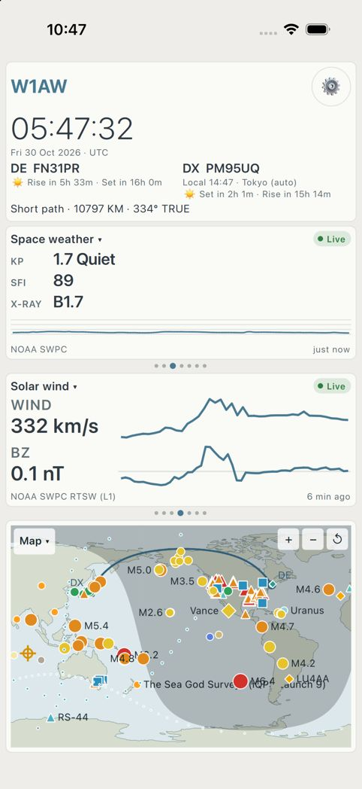
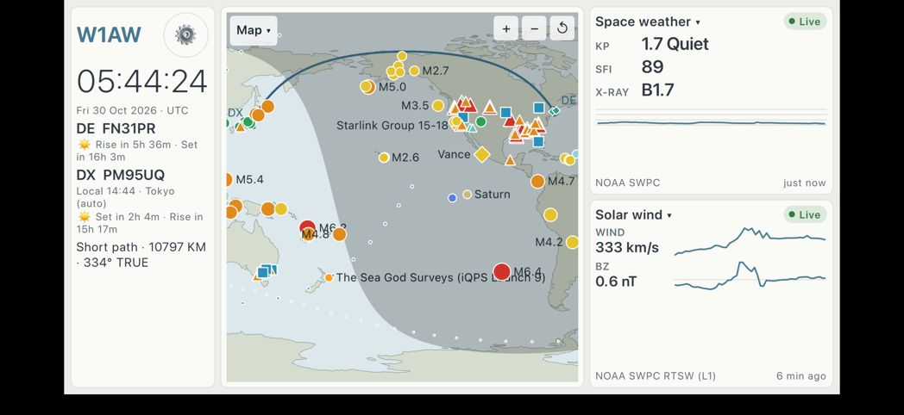
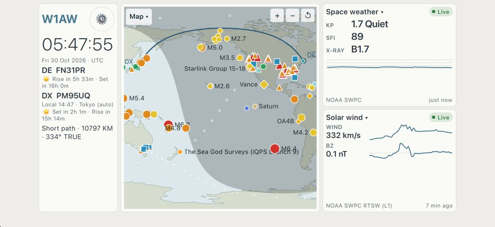
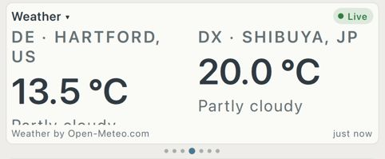
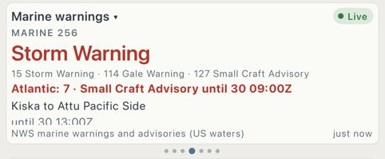
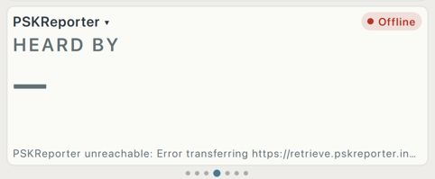
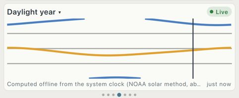

# iPhone final QA (1.0)

Pass run 2026-10-29/30 against `origin/main` at 7a40add (Release build for the simulator),
on an iPhone 17 simulator with iOS 26.5 created for this pass. Test station W1AW, FN31pr,
DX Tokyo (35.68, 139.69).

## What limited this pass

The pass covered less than planned. Three things got in the way:

1. **No touch input.** The simulator control tool asks the user to grant access to each
   simulator. That request was never answered, so the pass could not tap, swipe or type.
2. **No fallback driver.** Xcode 27.2 is installed with an older CoreSimulator (1174.9.2;
   Xcode expects 1174.21). Because of that, `xcrun simctl` hangs inside
   `xcodebuild -runFirstLaunch`: two such processes are stuck, one from another session.
   `xcodebuild` also turns off simulator destinations, so an XCUITest tap driver cannot run
   either. Fix: the owner runs `sudo xcodebuild -runFirstLaunch` (or opens Xcode once and
   lets it install its components). Calling CoreSimulator's own `simctl` directly still
   works for install, launch, screenshots and appearance.
3. **The machine was not quiet.** The load average was 29–35 when the pass started: two
   long-running Python jobs plus other agents' builds. So the earlier report of typed text
   arriving seconds late and the Paste/Select menu sticking is **neither confirmed nor
   ruled out**.

Because of (1) and (2), the pass used only things that need no touch: launch arguments
(`--pane N=id`, `--first-run`, `-c <config dir>`), config files (an orientation lock for
landscape, a forced appearance), `simctl ui appearance`, background/foreground through
another app, and screenshots.

**Not tested in this pass. These still need a hands-on run before Monday:**
- typing speed and keyboard behaviour in text fields, including the Paste/Select menu
- the time zone picker and the Accounts section
- pane swiping (#688 is still open) and the pane chooser and options
- the map menu (overlays, projections, centres), map zoom and pan, tapping DE/DX on the map
- Big Clock and Timers
- Satellite alerts: Allow, then Send test alert
- device rotation by gesture. Landscape was checked with the orientation lock instead.

iOS 27 was not tried, because #698 (the UIScene shim) is still open.

## Tested and working

- **First launch, unconfigured.** The station card offers "Set up", and the panes and map
  load live data. `--first-run` opens Settings with the Station section first.
- **Configured dashboard**, portrait, light and dark: station card, two panes and the map.
- **Every widget available on iOS at phone size**, light and dark: aprs, balloons,
  bandactivity, bands, bandsmatrix, beacons, daylight, dxcluster, eclipse, eme, fires, firewx,
  hamsat, launches, lookup, marine, mesh, ota, passes, planets, pskreporter, quakes,
  satellites, solaralerts, solaraurora, solardrap, solardst, solarhamqsl, solarimage,
  solarimpact, solarscales, solartrend, solarwind, spaceweather, storms, sunmoon, weather.
  Panes that need an account or host ("Set up") say so and offer Open Settings.
  `adif` is not registered on iOS (`--pane 1=adif`: "Unknown widget or pane"). The launches
  that paired `gps`, `radio`, `rotator` and `sensors` with another widget also exited,
  consistent with those being desktop-only.
- **Landscape** (orientation lock), light and dark: station column, map and two panes.
- **Background and foreground.** The app sat behind the Settings app for about 60 s and came
  back with the same process. The clock was current, data refreshed, and nothing was lost.
- **Live appearance change while running** (system dark to light): the whole page re-themes.
- **A forced Dark theme on a light system** renders correctly.
- **Consistency:** Satellites ("RS-44 in 52 min") and Passes ("RS-44 06:45Z") agree.

## Bugs

| # | Severity | Status | Bug |
|---|----------|--------|-----|
| 1 | High (looks broken in light mode, shows in App Store shots) | **Fixed, #718** | Black bands around the app |
| 2 | Medium | Open, covered by #701 | Weather pane cuts off the DE sky line |
| 3 | Medium | Open, #701 touches it | Marine warnings pane cuts off its last line |
| 4 | Medium | Open, #695 | Map labels overprint markers and other labels |
| 5 | Medium | Open, #690 | HF path reliability says "HF closed now" |
| 6 | Low | Open, #696 | D-RAP says "Max 0.0 MHz" on a quiet day |
| 7 | Low | Not fixed | PSKReporter pane shows a raw transport error |
| 8 | Low | Not fixed | Daylight year chart breaks its curves at the edges |
| 9 | Low | Open, #705 | First-run time zone defaults to the device's zone |
| 10 | Cosmetic | Not fixed | Small label nits |

### 1. Black bands around the app (fixed, #718)
Steps: launch in light mode, portrait or landscape. Qt keeps its view inside the safe area,
so the status bar, the home-indicator strip and the landscape side insets show the host
window's black, with white status bar text. #718 paints the page colour there and makes the
status bar text follow it. It works with a forced theme and with a live appearance change.

| Before | After |
|---|---|
|  |  |
|  |  |

### 2. Weather pane cuts off the DE sky line
Steps: put Weather in a phone pane, light mode, with DE in Hartford. "DE · HARTFORD, US"
wraps to two lines (the `wrapLabel` change in d33be41), which pushes "Partly cloudy" below
the pane edge. #701 rewrites this card (the place gets its own elided line), so this was not
fixed separately. Check it again once #701 merges.

### 3. Marine warnings pane cuts off its last line
Steps: put Marine warnings in a phone pane while warnings are active. The end time
("until 30 13:00Z") is cut off at the bottom. #701 changes MarineCard; check it again after
that merges.

### 4. Map labels overprint markers and other labels
Examples: "M6.4" over "The Sea God Surveys (iQPS Launch 9)", "M4.8" over "M6.2", and the DE
label partly behind spot markers. This happens in portrait and landscape. #695 covers it.

### 5. HF path reliability says "HF closed now"
At 05:30Z it showed 0–1 % on every band from FN31 to Tokyo. #690 covers it.

### 6. D-RAP says "Max 0.0 MHz" on a quiet day
#696 covers it.

### 7. PSKReporter pane shows a raw transport error
The footer reads "PSKReporter unreachable: Error transferring https://retrieve.pskreporter.in…",
which is a raw Qt network error with the URL cut short. It would read better as a short
sentence such as "PSKReporter is not responding; trying again in N min". Low priority:
PSKReporter rate-limits, and #673 (polling robustness) is open in this area.

### 8. Daylight year chart breaks its curves at the edges
DE sunset in UTC crosses 00:00 during the year. The chart draws that curve as broken pieces
at the top and bottom edges, which looks like a drawing glitch rather than a wrap. It would
read better unwrapped, or with a marker at the wrap. Not fixed: #701 touches DaylightCard.

### 9. First-run time zone defaults to the device's zone
Before any location is entered, the Station time zone shows the device's zone (Los Angeles
on this Mac-hosted simulator). #705 makes the zone follow the station's location.

### 10. Small label nits
- Fire weather shows "FIRE WX 0" above "None active".
- The Sun (SDO) caption "AIA 193 Å" is drawn as outlined text beside a small image.

## Build notes

- Configuring with `-DCMAKE_CONFIGURATION_TYPES=Release` does **not** get around the
  shared kit's missing `_debug.a` libraries, because CMake checks the imported targets for
  every configuration. What worked: an APFS clone of `~/Qt/6.5.3/ios` inside the worktree
  (`cp -cR`, so no disk cost), with the four release libraries copied to the `_debug.a` names.
- Desktop `ctest`: 205/205 on main, 207/207 with #718.

## Verdict

The parts that could be checked look ready: rendering, theming, data and lifecycle on an
iOS 26.5 iPhone. #718 removes the most visible problem, the black bands in light mode. The
remaining layout issues on main are cosmetic, and open PRs (#701, #695, #690, #696)
already cover them.

**The interactive flows were not exercised in this pass**: typing, pickers, swiping, the
pane chooser, the map menu, Big Clock, Timers and the satellite-alert permission. So this
pass cannot sign off the iPhone app for Monday on its own. Before release, run a
30–45 minute hands-on pass with simulator access granted, CoreSimulator updated and a quiet
machine, over the "Not tested" list above.
